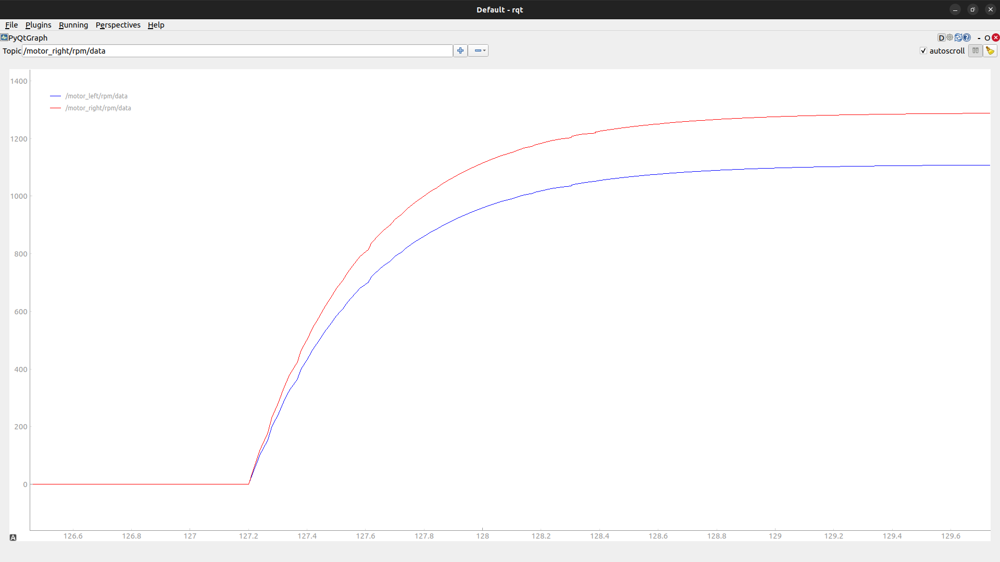
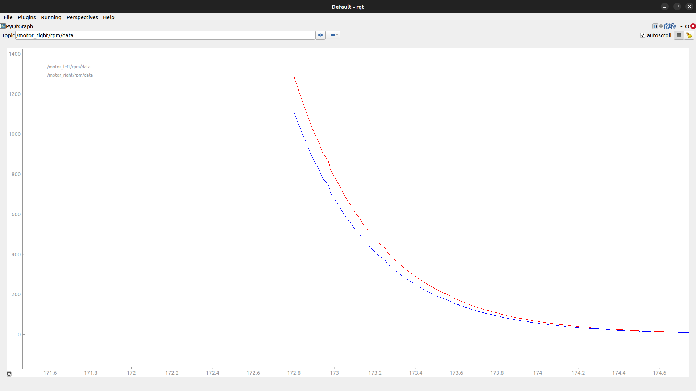

# eyerov_motor_sim

A ROS 2 (Humble, `rclpy`) package that acts as a **motor-control firmware simulator**:
it subscribes to `cmd_vel`, converts it to target motor RPM, simulates how real
motors respond, and streams the resulting RPM as telemetry.

```
/cmd_vel (Twist) ──▶ mixer ──▶ target RPM ──▶ motor model ──▶ /motor_<name>/rpm
                                   │                │
                                   └─ watchdog ─────┘  (zero targets if cmd_vel goes stale)
```

## Interfaces

| Direction | Topic | Type | Meaning |
|---|---|---|---|
| Sub | `/cmd_vel` | `geometry_msgs/Twist` | uses `linear.x`, `linear.z`, `angular.z` |
| Pub | `/motor_left/rpm`, `/motor_right/rpm`, `/motor_vertical/rpm` | `std_msgs/Float32` | simulated motor speed (telemetry) |
| Pub | `/motor_<name>/target_rpm` | `std_msgs/Float32` | commanded target (handy for plotting vs actual) |

Topic names are relative, so they can be remapped or namespaced.

## Assumptions (the task leaves the thruster layout open)

* Two horizontal thrusters (left/right, `track_width` apart) plus one vertical thruster.
* REP-103 conventions: +x forward, +z up, +`angular.z` = turn left (right motor spins faster).
* Differential mixing: `left = vx - wz*L/2`, `right = vx + wz*L/2`.
* `max_speed` (m/s) maps linearly to `max_rpm`. Negative RPM = reverse.
* If a side would exceed the limit, both sides are scaled together so the turn ratio is kept.

## Motor model

Per control step of `dt` seconds:

1. **Deadband** – `|target| < deadband_rpm` is treated as 0.
2. **Saturation** – target clamped to `±max_rpm`.
3. **First-order lag** – `rpm += (target - rpm) * (1 - exp(-dt/tau))`
   (exact discretisation, stable for any `dt`).
4. **Acceleration limit** – `|Δrpm| ≤ max_accel_rpm_s * dt`.

**Watchdog:** if no `cmd_vel` arrives for `cmd_timeout_s`, targets drop to 0 and the
motors spin down, like a firmware failsafe. It clears automatically when commands resume.
NaN/inf commands are rejected.

**Loop structure:** the subscriber only stores the latest command; a fixed-rate
timer (`publish_rate_hz`) runs the simulation and publishes, like a firmware control loop.

## Parameters (`config/motor_sim.yaml`)

| Name | Default | Description |
|---|---|---|
| `max_rpm` | 3000.0 | motor saturation limit |
| `max_speed` | 1.0 | m/s that corresponds to `max_rpm` |
| `track_width` | 0.3 | m between left and right thrusters |
| `tau` | 0.4 | s, lag time constant (0 = instant) |
| `max_accel_rpm_s` | 6000.0 | RPM/s slew limit (0 = unlimited) |
| `deadband_rpm` | 20.0 | targets below this are ignored |
| `publish_rate_hz` | 50.0 | control loop and telemetry rate |
| `cmd_timeout_s` | 0.5 | watchdog timeout (0 = disabled) |
| `noise_std_rpm` | 0.0 | Gaussian noise added to reported RPM |

Use decimals in YAML (`3000.0`, not `3000`) so values parse as doubles.

## Build and run (ROS 2 Humble)

```bash
mkdir -p ~/ros2_ws/src && cp -r eyerov_motor_sim ~/ros2_ws/src/
cd ~/ros2_ws
source /opt/ros/humble/setup.bash
rosdep install --from-paths src --ignore-src -y
colcon build --packages-select eyerov_motor_sim
source install/setup.bash

ros2 launch eyerov_motor_sim motor_sim.launch.py
```

## Try it

In a second terminal (`source install/setup.bash` first):

```bash
# drive forward while turning left
ros2 topic pub -r 10 /cmd_vel geometry_msgs/msg/Twist \
  "{linear: {x: 0.5, z: 0.0}, angular: {z: 0.2}}"

# watch telemetry
ros2 topic echo /motor_left/rpm
ros2 topic echo /motor_right/rpm

# plot target vs actual (shows the lag/ramp)
ros2 run rqt_plot rqt_plot /motor_left/rpm/data /motor_left/target_rpm/data
```

Stop the publisher and the RPM decays to 0 after the watchdog timeout.

## Tests

```bash
colcon test --packages-select eyerov_motor_sim && colcon test-result --verbose
# or, from the package folder:  python3 -m pytest test/
```

The mixer and motor model are plain Python (no ROS imports), so the maths is
unit-tested independently of ROS: mixing signs, clamping, lag time constant,
no overshoot, acceleration limit, deadband, reverse, large `dt` stability.

## Results

Tested on Ubuntu 22.04 with ROS 2 Humble. Plots were made with rqt (PyQtGraph backend);
blue = `/motor_left/rpm`, red = `/motor_right/rpm`.

**Command used**
```bash
ros2 topic pub -r 10 /cmd_vel geometry_msgs/msg/Twist \
  "{linear: {x: 0.4}, angular: {z: 0.2}}"
```

**Expected steady-state values** (`track_width = 0.3`, `max_speed = 1.0`, `max_rpm = 3000`):
left = (0.4 − 0.03) × 3000 = **1110 RPM**, right = (0.4 + 0.03) × 3000 = **1290 RPM**.
The right motor spins faster because positive `angular.z` means turning left.

### 1. Step response

When the command starts, both motors ramp up smoothly from 0 and settle at 1110 and
1290 RPM in about 2 seconds, with no overshoot. The left motor reaches about 63% of its
final value (~700 RPM) roughly 0.4 s after the command starts, matching the configured
time constant `tau = 0.4 s`.



### 2. Watchdog failsafe

When `cmd_vel` stops, the motors hold their speed until the watchdog (0.5 s) trips and
sets the targets to 0. The RPM then decays smoothly to 0 in under 2 seconds instead of
stopping instantly, as a real motor would.



### 3. Telemetry rate

`ros2 topic hz /motor_left/rpm` reports about 50 Hz, matching `publish_rate_hz`.

### Demo video

Ramp-up, stop, decay and restart in one clip: [https://youtu.be/mfolmz8WGjo]

## Possible extensions

* Custom telemetry message (rpm, target, current, temperature) instead of `Float32`.
* Full 6-DOF thruster allocation matrix for a vectored ROV.
* Dynamic parameter reconfiguration at runtime.
* Fault injection (stalled motor, dropped telemetry).
